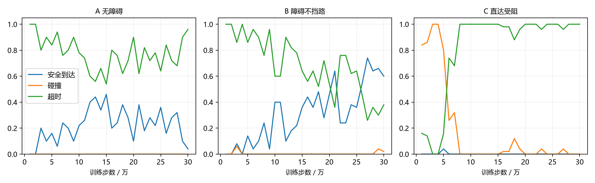
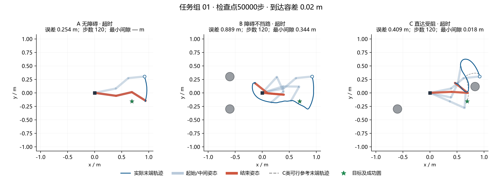
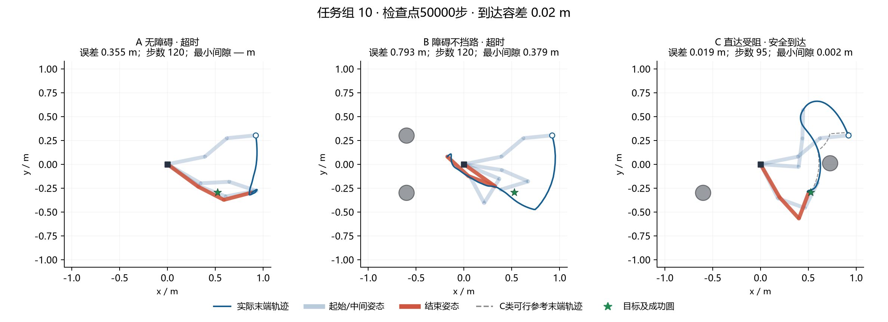
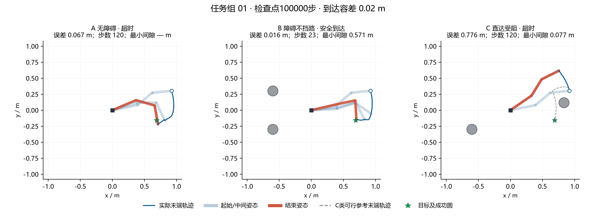
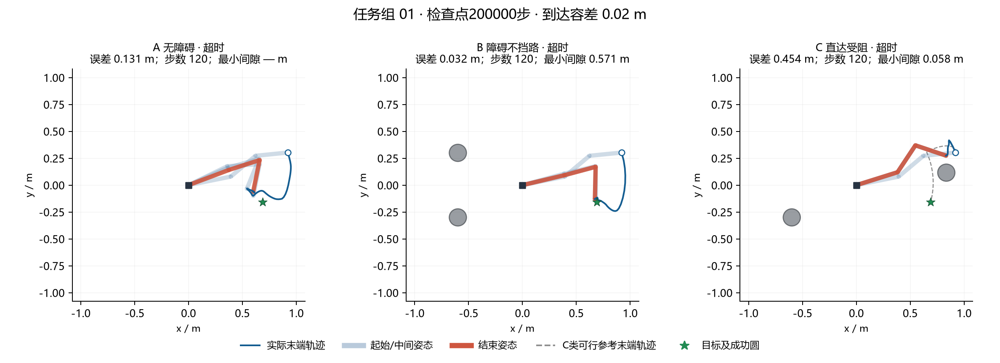
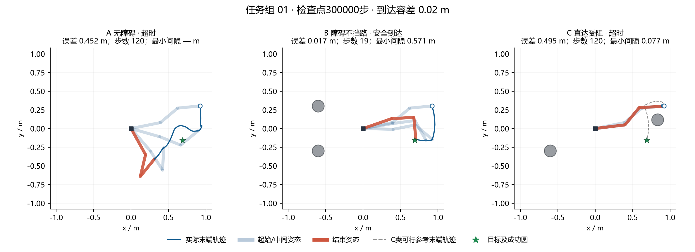

# SAC修订方案种子0训练诊断

种子0完成300000环境步，用时51.9分钟。后续种子按用户决定暂缓。本报告仅使用训练样本和既有验证集，不使用独立测试集，也不改奖励或模型。

按原选择规则保留的模型来自50000步。它尚未进入受阻任务训练阶段（受阻任务在50000步之后开始采样），因此不能将这个检查点的少量受阻成功归因于受阻训练。

## 检查点表现

| 步数 | 场景 | 安全成功率 | 碰撞率 | 超时率 | 平均终点误差/m | 平均归一化动作范数 |
|---:|---|---:|---:|---:|---:|---:|
| 50000 | A | 0.16 | 0.00 | 0.84 | 0.266 | 0.552 |
| 50000 | B | 0.14 | 0.00 | 0.86 | 0.518 | 0.861 |
| 50000 | C | 0.04 | 0.80 | 0.16 | 0.417 | 0.911 |
| 100000 | A | 0.22 | 0.00 | 0.78 | 0.215 | 0.594 |
| 100000 | B | 0.40 | 0.00 | 0.60 | 0.267 | 0.750 |
| 100000 | C | 0.00 | 0.00 | 1.00 | 0.802 | 0.328 |
| 200000 | A | 0.10 | 0.00 | 0.90 | 0.292 | 0.602 |
| 200000 | B | 0.46 | 0.00 | 0.54 | 0.083 | 0.734 |
| 200000 | C | 0.00 | 0.00 | 1.00 | 0.601 | 0.130 |
| 300000 | A | 0.04 | 0.00 | 0.96 | 0.272 | 0.788 |
| 300000 | B | 0.60 | 0.02 | 0.38 | 0.088 | 1.006 |
| 300000 | C | 0.00 | 0.00 | 1.00 | 0.610 | 0.169 |

每类50个固定验证任务。这里是训练诊断，不是独立测试成绩。高超时率说明未能完成任务；动作范数和轨迹可帮助区分停滞、抖动、绕行失败，不能把所有超时都叫作碰撞。

受阻场景由5万步检查点的碰撞率80%变为最终的0%，超时率由16%变为100%，平均归一化动作范数从0.911降至0.169。最终表现更接近保守停留或小范围运动，未形成到达目标的有效绕行。碰撞减少不能单独算作完成避障到达。这个观察尚不能归因于某一奖励项。

## 已确认的时间语义问题

同一姿态、目标、障碍和动作，在第1步与第120步的21维观测相同，但奖励分别为-0.01和-5.01。超时返回terminated=False、truncated=True；训练入口仅把terminated写入回放终止标记，因此超时仍计算后继Q值。

本轮将120步与额外−5超时惩罚作为任务失败条件，却沿用了旧入口的外部截断处理，且观测中没有剩余时间。这是任务定义与时间处理未对齐的实现问题。它可能影响价值学习，但本次未做受控重训，不能断言它是唯一或主要失败原因。

有限时域任务应把时间上限作为终止并提供剩余时间；如果只是外部采样截断，应保持自举并重新审视超时惩罚。[Farama官方解释](https://farama.org/Gymnasium-Terminated-Truncated-Step-API)

## 其他观察与解释边界

无障碍和不挡路任务本身也未稳定收敛，因此不能只把失败归因于绕障过难。进入受阻任务占比更高的阶段后，稳定成功仍未出现；这提示应先验证基础学习流程，再扩大种子。

参考路径奖励高于停滞只验证了回报量级，没有证明随机探索容易发现这些成功路径。困难任务的稀少成功经验、密集安全惩罚与训练分布变化均可能影响学习，尚无消融证据区分它们。

## 建议的后续顺序

1. 先统一有限时域终止、自举掩码和时间观测；新增对应测试，保留本次模型作为诊断版本。
2. 使用少量固定、可解的无障碍和不挡路任务检查稳定到达，设置小规模预实验门槛。
3. 通过后逐步加入少量受阻任务，检查真实绕行轨迹和成功经验，再决定是否重跑大预算多种子。
4. 本次不自动改奖励、训练预算或任务难度；下一轮修订需要明确新协议，独立测试仍保持未用于选择。

## 配对轨迹

**检查点50000步，第1组**

**检查点50000步，第10组**

**检查点100000步，第1组**

**检查点200000步，第1组**

**检查点300000步，第1组**

## 数据

- [诊断汇总](diagnosis.json)、[检查点指标CSV](checkpoint_metrics.csv)
- [完整验证轨迹](validation_trajectories.json)、[回报复算](trajectory_returns.json)
- [训练样本表现](training_sample.json)、[时间语义复现](timeout_semantics.json)
- [检查记录](checks.json)：四个检查点复现与原验证日志一致，600条诊断轨迹加密复核无漏碰撞，原任务、模型及论文哈希检查通过。
