# 现有SAC机械臂模型的有限绕障验证

本报告评估已有两个 SAC 模型在配对障碍场景中的安全到达表现。共固定 10 组、30 个任务，记录 240 个评估回合。模型权重和原 13 维观测保持原样，未重新训练；本报告不修改原论文。

## 主要结果

在 0.08 m 容差的 C 类直达受阻任务中，SAC 种子0 为 0/10；SAC 种子1 为 0/10。本次评估未获得该容差下 SAC 安全绕障到达的成功案例，不能据此声称现有模型已通过这组主动绕障验证；也不能由此推断所有其他任务都无法绕障。

在 0.02 m 容差的 C 类直达受阻任务中，SAC 种子0 为 0/10；SAC 种子1 为 0/10。本次评估未获得该容差下 SAC 安全绕障到达的成功案例，不能据此声称现有模型已通过这组主动绕障验证；也不能由此推断所有其他任务都无法绕障。

主要配对证据：SAC 种子0 在 0.08 m 容差下的 B 类成功 10/10、C 类成功 0/10；其中 10 组从障碍不挡路时成功，变为直达受阻后失败。每组起点、目标和障碍数量相同，仅移动一个障碍，因此 B→C 是本次判断阻挡影响的主要对照。原始 A→C 结果仍保存在配对数据中。

主要配对证据：SAC 种子1 在 0.08 m 容差下的 B 类成功 10/10、C 类成功 0/10；其中 10 组从障碍不挡路时成功，变为直达受阻后失败。每组起点、目标和障碍数量相同，仅移动一个障碍，因此 B→C 是本次判断阻挡影响的主要对照。原始 A→C 结果仍保存在配对数据中。

A 类无障碍测试需要单独解读：原观测构造会把四维障碍特征全部置零，而现有模型主要在含两个障碍的环境中训练；移除障碍也改变了观测分布。A 类成绩较低可能与这种分布变化有关，这一解释尚未经因果验证，不能仅凭 A 类失败认定模型缺乏基础到达能力。B 类保留了两个障碍，更适合作为本次配对到达参照。

DLS有、无避障项两个版本也均未通过本次C类任务。每个任务已有满足步数及碰撞检查条件的参考路径，因而这些失败不能简单解释为任务无解；结论限于所测控制器及构造场景，不能推广为SAC算法普遍无法避障。

0.02 m 测试同时提高了到达精度要求。现有模型原本以 0.08 m 容差训练，因此严格测试失败须结合碰撞、超时和最终误差分析，不能全部归因于避障能力。

A/B/C 轨迹随布局发生变化可补充说明障碍适应，但路径变化本身不等于正确避障。无避障 DLS 在 C 类的表现是对照事实，不是筛选任务的条件；任务和参考路径均在控制器评估前固定。

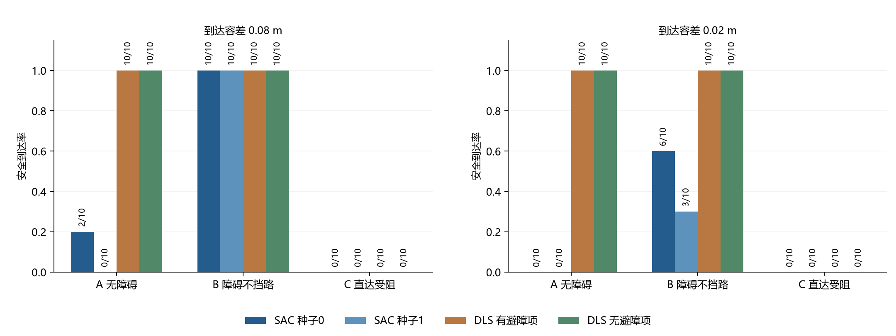

## 任务构造和信息条件

生成种子为 20261107。每组 A/B/C 使用同一起始关节角与目标；初始关节角为 [0.2, 0.5, −0.6] rad，基座在原点，连杆长 [0.40, 0.30, 0.30] m，连杆半径 0.02 m。目标位于距基座 0.55～0.95 m、初始末端方向 ±0.9 rad 的区域，起始末端到目标至少 0.20 m。

| 场景 | 定义 | 核验用途 |
|---|---|---|
| A 无障碍 | 移除障碍，保持同组起点和目标，四维障碍输入变为零 | 无障碍输入条件下的到达表现，含观测分布变化 |
| B 障碍不挡路 | 两个半径 0.08 m 的圆形障碍位于后方，并验证参考路径不被阻挡 | 普通障碍场景 |
| C 直达受阻 | 仅移动 B 的一个障碍至直接到达通道，另一个保持原位 | 检验应对实际阻挡的能力 |

C 类移动障碍的圆心位于初始末端—目标线段内部附近，到线段距离小于 0.015 m。该条件把 0.02 m 连杆半径、整个 0.08 m 成功圆以及 0.005 m 阻挡裕量计入判定，避免只挡目标中心而仍允许直达成功圆边缘。每组另外保存无碰撞的目标关节姿态与参考路径，验证在相同动作限幅和 120 步限制下可以到达，参考路径要求至少 0.01 m 表面间隙。

可行参考路径仅用于证明这些测试任务具有可行解及辅助画图，不提供给 SAC。B 类“不挡路”指障碍不阻挡已验证的参考路线，不保证任意控制器产生的轨迹都安全。候选接受与拒绝只根据几何和参考路径，不依据 SAC 或 DLS 成绩。

生成过程检查 297 个候选，接受 10 组。拒绝原因计数：`{"goal_outside_original_sector": 271, "start_goal_too_close": 3, "goal_success_region_clearance": 6, "reference_exceeds_step_limit": 1, "initial_arm_clearance": 6}`。完整记录见 [generation_log.json](generation_log.json)。

候选目标并非按照原论文的半径与角度均匀采样：本次先在 [-π,π]³ 内均匀采样目标关节姿态，再通过正运动学得到末端目标，筛选扇区、起终距离、阻挡和参考路径条件。即使坐标范围相同，目标分布也不同。可行性筛选和固定后方障碍进一步形成构造测试的选择偏差，因此本测试不能估计原论文任务分布或一般随机场景的成功率。

## 控制器、奖励与评估口径

四种方法为 SAC 种子0、SAC 种子1、DLS关闭避障项和DLS保留避障项。SAC输入仍是三个关节角、末端坐标、目标坐标、目标位移和四维障碍距离信息，评估使用确定性动作；DLS直接使用环境几何。两者的信息条件不同，本实验不据此声称某算法普遍优越。

每次关节动作限于 ±0.05 rad，关节限幅 ±π，最多120步。两次容差评估使用完全相同的任务和模型，仅分别以 0.08 m 与 0.02 m 为末端到达阈值。评估不更新模型，也不以奖励高低判定结果。原模型训练中的奖励和网络权重未改动。

安全到达、碰撞和超时互斥，碰撞优先。间隙为连杆中心线到障碍圆心距离减去障碍半径与连杆半径；接触或重叠判为碰撞。无障碍任务的间隙为不适用，CSV留空而不是写成0。最小间隙包括初始姿态与动作中的检查点。

每个动作按最大关节变化不超过0.001 rad细分检查，首次检测到碰撞立即终止；保存轨迹再以0.0005 rad复核。该检查是有限分辨率的运动段检查，不是数学连续安全证明；不涵盖动力学、执行器误差或自碰撞。

以下平均终点误差包含全部回合；平均步数和末端路径长度只统计安全成功回合。若没有成功回合，相应均值标为“—”。两个SAC种子分别报告，未将同一批任务在两个模型上的结果视为独立的新任务样本。

### 到达容差 0.08 m

| 场景 | 方法 | 安全到达 | 碰撞 | 超时 | 平均终点误差/m | 成功回合平均步数 | 成功回合平均路径/m |
|---|---|---:|---:|---:|---:|---:|---:|
| A 无障碍 | SAC 种子0 | 2/10 | 0 | 8 | 0.719 | 35.0 | 0.945 |
| A 无障碍 | SAC 种子1 | 0/10 | 0 | 10 | 0.533 | — | — |
| A 无障碍 | DLS 无避障项 | 10/10 | 0 | 0 | 0.055 | 15.3 | 0.670 |
| A 无障碍 | DLS 有避障项 | 10/10 | 0 | 0 | 0.055 | 15.3 | 0.670 |
| B 障碍不挡路 | SAC 种子0 | 10/10 | 0 | 0 | 0.067 | 11.9 | 0.714 |
| B 障碍不挡路 | SAC 种子1 | 10/10 | 0 | 0 | 0.075 | 12.0 | 0.711 |
| B 障碍不挡路 | DLS 无避障项 | 10/10 | 0 | 0 | 0.055 | 15.3 | 0.670 |
| B 障碍不挡路 | DLS 有避障项 | 10/10 | 0 | 0 | 0.055 | 15.3 | 0.670 |
| C 直达受阻 | SAC 种子0 | 0/10 | 5 | 5 | 0.560 | — | — |
| C 直达受阻 | SAC 种子1 | 0/10 | 8 | 2 | 0.710 | — | — |
| C 直达受阻 | DLS 无避障项 | 0/10 | 10 | 0 | 0.503 | — | — |
| C 直达受阻 | DLS 有避障项 | 0/10 | 10 | 0 | 0.498 | — | — |

### 到达容差 0.02 m

| 场景 | 方法 | 安全到达 | 碰撞 | 超时 | 平均终点误差/m | 成功回合平均步数 | 成功回合平均路径/m |
|---|---|---:|---:|---:|---:|---:|---:|
| A 无障碍 | SAC 种子0 | 0/10 | 0 | 10 | 0.756 | — | — |
| A 无障碍 | SAC 种子1 | 0/10 | 0 | 10 | 0.533 | — | — |
| A 无障碍 | DLS 无避障项 | 10/10 | 0 | 0 | 0.009 | 17.6 | 0.719 |
| A 无障碍 | DLS 有避障项 | 10/10 | 0 | 0 | 0.009 | 17.6 | 0.719 |
| B 障碍不挡路 | SAC 种子0 | 6/10 | 0 | 4 | 0.021 | 14.8 | 0.766 |
| B 障碍不挡路 | SAC 种子1 | 3/10 | 1 | 6 | 0.232 | 16.3 | 0.797 |
| B 障碍不挡路 | DLS 无避障项 | 10/10 | 0 | 0 | 0.009 | 17.6 | 0.719 |
| B 障碍不挡路 | DLS 有避障项 | 10/10 | 0 | 0 | 0.009 | 17.6 | 0.719 |
| C 直达受阻 | SAC 种子0 | 0/10 | 5 | 5 | 0.560 | — | — |
| C 直达受阻 | SAC 种子1 | 0/10 | 8 | 2 | 0.710 | — | — |
| C 直达受阻 | DLS 无避障项 | 0/10 | 10 | 0 | 0.503 | — | — |
| C 直达受阻 | DLS 有避障项 | 0/10 | 10 | 0 | 0.498 | — | — |

## 检查和复核记录

自动检查总体状态：**通过**。预期回合数 240，实际 240。详细的中途碰撞、终点与碰撞同时发生、关节限幅、容差、参考路径重放和重复运行检查见 [checks.json](checks.json)。

轨迹加密复核记录数：240；检测到粗检查漏碰撞回合数：0；是否以更细分辨率重新评估：否。详细结果见 [refinement.json](refinement.json)。若检查未通过，结果应视为诊断材料，不作为已验证结论。

模型文件SHA-256与运行环境记录见 [config.json](config.json)，固定任务和参考路径见 [tasks.json](tasks.json)。

## 固定展示的配对轨迹

下列任务组在评估前指定为第1、5、10组，包含两个SAC模型与两种到达容差，不按结果挑选。蓝线为实际末端轨迹，浅蓝为起始/中间整臂姿态，橙色为结束姿态，灰色圆为实际障碍；C类灰虚线为可行参考末端轨迹。连杆按0.02 m物理半径绘制。成功圆大小随评估容差变化。

**第1组，SAC 种子0，容差0.08 m**

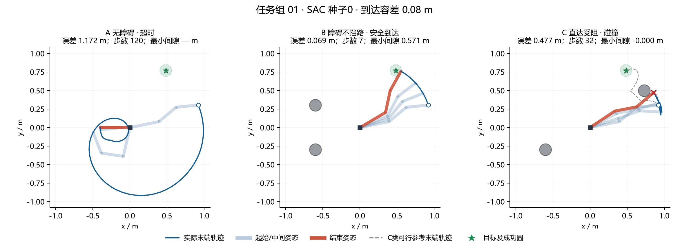

**第1组，SAC 种子0，容差0.02 m**


**第1组，SAC 种子1，容差0.08 m**


**第1组，SAC 种子1，容差0.02 m**


**第5组，SAC 种子0，容差0.08 m**

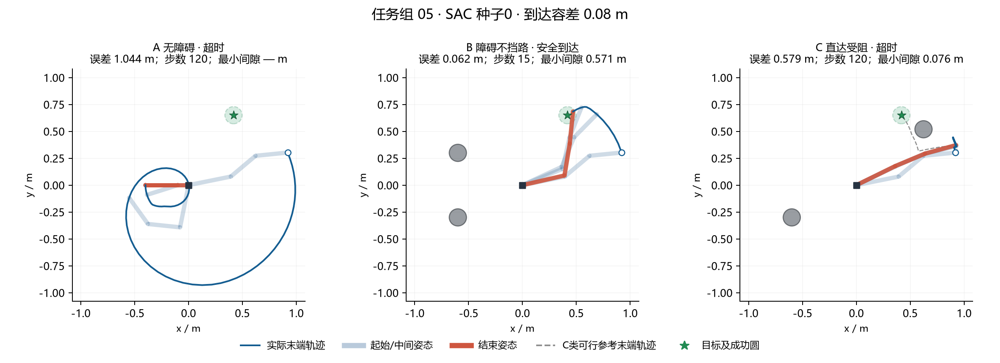

**第5组，SAC 种子0，容差0.02 m**

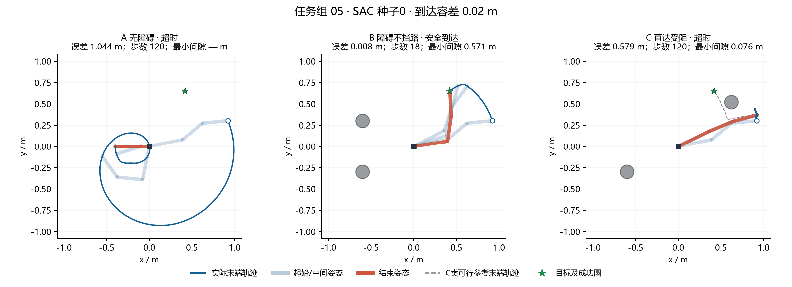

**第5组，SAC 种子1，容差0.08 m**

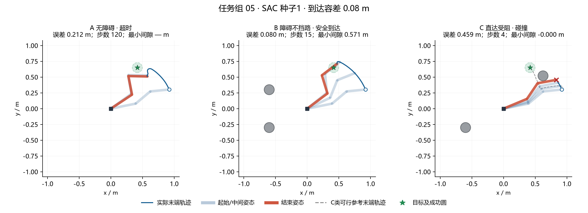

**第5组，SAC 种子1，容差0.02 m**

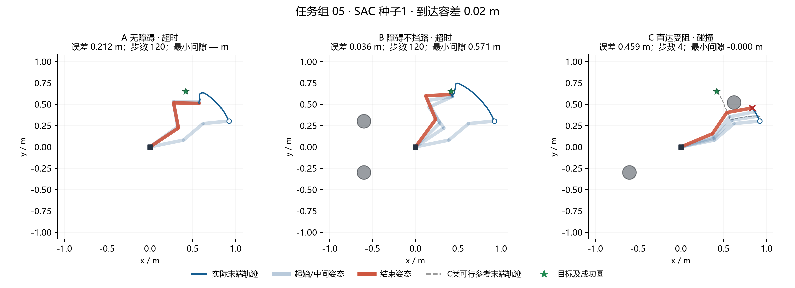

**第10组，SAC 种子0，容差0.08 m**

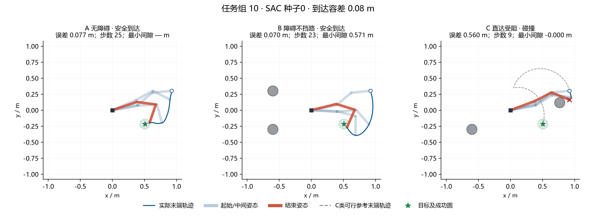

**第10组，SAC 种子0，容差0.02 m**

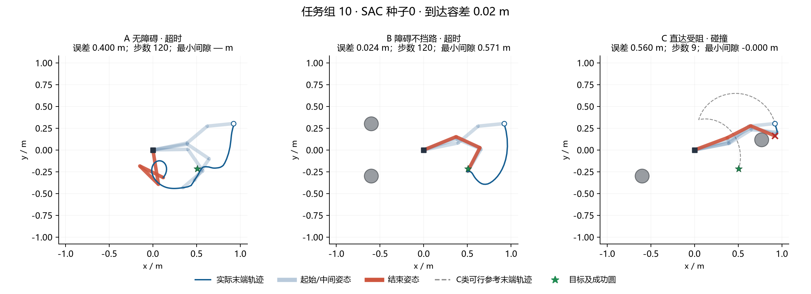

**第10组，SAC 种子1，容差0.08 m**

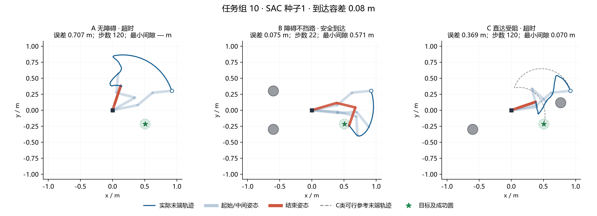

**第10组，SAC 种子1，容差0.02 m**

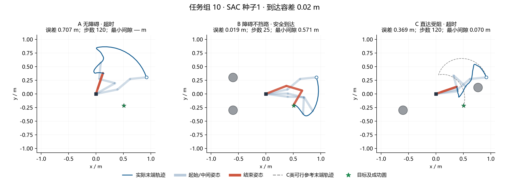

## 按编号选择的首个失败案例

对每个方法和容差组合，按任务组编号、再按A/B/C顺序选取首个失败，展示其完整配对场景。相同任务可能也出现在固定展示中。没有失败的组合不人为补例。

**DLS 有避障项，容差0.08 m：首个失败为第1组C类**


**DLS 有避障项，容差0.02 m：首个失败为第1组C类**

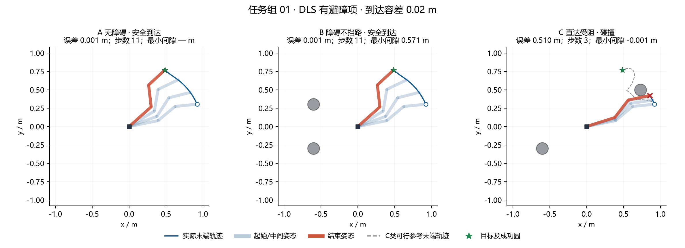

**DLS 无避障项，容差0.08 m：首个失败为第1组C类**

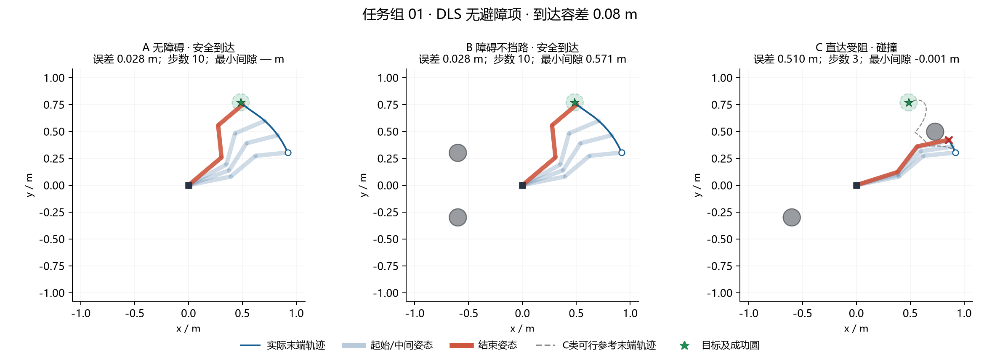

**DLS 无避障项，容差0.02 m：首个失败为第1组C类**


**SAC 种子0，容差0.08 m：首个失败为第1组A类**


**SAC 种子0，容差0.02 m：首个失败为第1组A类**

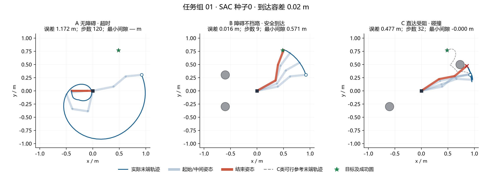

**SAC 种子1，容差0.08 m：首个失败为第1组A类**


**SAC 种子1，容差0.02 m：首个失败为第1组A类**

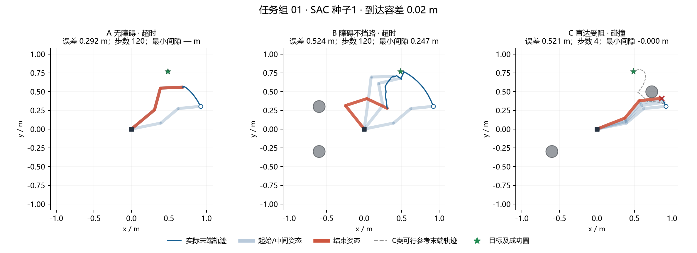

## 结论适用范围与数据文件

本次是小规模、针对几何阻挡的构造测试，不能估计任意随机环境的总体成功概率。固定初始姿态、静态圆形障碍、运动学模型和压缩障碍观测均限制了外推范围。新任务的障碍位置及更严格的运动段碰撞检查与原论文随机评估不同，不能直接以两次成功率差值解释模型进步或退步。

路径长度和步数均值存在成功样本选择差异；应与成功任务数一起阅读。配对轨迹RMS差异只是相同步数前缀上的描述量，不是显著性检验，也不单独证明安全避障。

## 复现命令

在项目根目录运行以下命令，仅从固定JSON重新生成报告、CSV和图表，不运行控制器，不修改任务、模型或逐回合结果：

```powershell
$env:MPLCONFIGDIR = Join-Path (Get-Location) 'arm_rl/avoidance_validation_20261107/.mplconfig'
python -B arm_rl/avoidance_report.py arm_rl/avoidance_validation_20261107
```

如需另行核验原评估脚本，下面命令会在新目录重新生成任务并运行240回合，不训练模型；该操作不是本次报告收尾所执行的内容：

```powershell
python -B arm_rl/validate_avoidance.py --out arm_rl/avoidance_validation_reproduction --stage all
```

新目录应不存在。固定种子和已保存配置用于复现；跨运行环境的数值一致性应另行核对。原论文、环境与训练代码、模型权重均未因本次报告修订而修改。

- [episodes.csv](episodes.csv)：每个方法、任务、容差的最终状态和指标。
- [summary.csv](summary.csv)：按场景、方法、容差汇总，包含成功样本数与间隙指标。
- [paired.csv](paired.csv)：同组A/B/C结果和轨迹差异。
- [episodes.json](episodes.json)：完整逐步关节状态、动作、末端位置、误差和检查间隙。
- [tasks.json](tasks.json)：固定任务坐标、目标关节姿态、参考路径和阻挡几何。
- [generation_log.json](generation_log.json)：任务生成与拒绝原因。
- [checks.json](checks.json)、[refinement.json](refinement.json)：自动检查与轨迹加密复核。
- [config.json](config.json)：配置、运行环境与模型哈希。
